# Dependency tree

<!-- Generated by scripts/dependency-tree from docs/dependencies.toml and the files it counts. Do not edit by hand: change the TOML and run `python3 -I scripts/dependency-tree`. -->

What depends on what in rscode, and how much each open feature would unblock. Built from `docs/dependencies.toml` (the nodes and edges, by hand) and these counted sources: `upstream/settings.toml` and the settings export through `scripts/settings-port` (the same policy, so the totals match `settings-port report`), `tests/e2e-scenarios/*.md`, `DECISIONS.md` (ADR citations), `upstream/ports.toml`, and the phase table in `docs/research/extensions-compat.md` section 4.

## How to read the counts

- **Status.** `done`; `in-progress` (owned by a sibling worktree or the extension host); `todo`; `blocked-external` (needs a user action, a product decision or an environment). A node marked `deferred` is a user priority decision (ROADMAP) and is also a gate.
- **Direct.** What the node is named for: blocked settings whose reason it owns, exthost settings of the built-in extensions it owns, todo settings matched by its `todo_globs` (by key prefix, inferred), and smoke scenarios that name it as a blocker.
- **Free downstream.** Nodes that this node unblocks: every direct need is done, is this node, or is itself free. A node that also waits on a gate or on other unbuilt work is not free.
- **(+N) not yet unblocked.** Downstream items that stay blocked after this node. They wait on a gate (`blocked-external` or `deferred`) or on other unbuilt work. Gate numbers show what a user decision would unlock.
- **Dep vs todo settings.** `dep` = blocked and exthost settings: a real dependency recorded in settings.toml. `todo` = backlog settings matched by a prefix glob. They are shown but not scored.
- **Scenarios.** A smoke scenario with several blockers counts under each. Ready rows never count.
- **Score.** Free dep settings + free scenarios + 10 x free extensions. It only sorts the ranking. Todo settings do not count toward it.
- **Ranking.** A node is rankable when its status is `todo`, it is not `deferred`, and every node it needs is `done`. Nodes waiting on an in-progress node are listed separately.
- **Effort.** `(source)` is copied from docs/research/extensions-compat.md section 4 (the tests check it). `(guess)` is the author's estimate, not from a source.

## Totals from the files

| source | count | attributed to a node |
|---|---|---|
| settings: wired | 247 | n/a (done) |
| settings: blocked | 363 | 363 of 363 (by reason) |
| settings: exthost | 426 | 426 of 426 (by built-in extension) |
| settings: todo | 468 | 275 of 468 matched by a node's todo_globs |
| settings: n/a | 558 | not dependency-blocked (policy: product, Windows, deprecated) |
| smoke scenarios: ready | 73 | not blocked |
| smoke scenarios: pending | 9 | not attributed (free-text notes) |
| smoke scenarios: blocked | 111 | 110 name a feature that has a node; 1 names no feature (a settings-rule check) |
| unit-test rows in scenario files | 5 | not smoke scenarios; not counted |
| ADR headings in DECISIONS.md | 86 | every ADR cited by a node exists (latest ADR-0100) |
| upstream/ports.toml entries | 57 | not nodes (file ports, not features): partial 54, planned 1, ported 2 |

Settings in the export: 2062. Scenario rows: 198.

## Graph

An arrow means "is needed by": `A --> B` reads "B needs A". Stadium shape = an upstream extension rscode should run. Hexagon = blocked outside the code.

```mermaid
flowchart LR
  classDef done fill:#d4edda,stroke:#2e7d32,color:#1b3d20
  classDef inprogress fill:#fff3cd,stroke:#b8860b,color:#4a3b00
  classDef todo fill:#eceff1,stroke:#607d8b,color:#263238
  classDef external fill:#f8d7da,stroke:#b71c1c,color:#4a0f12
  n_ext_host_p0["Extension host P0: Node handshake (ADR-0060, ADR-0061) (done)"]:::done
  n_config_service["Configuration service and live reload (ADR-0022) (done)"]:::done
  n_command_registry["Command registry and Command Palette (ADR-0030) (done)"]:::done
  n_quick_open["Quick Open on a reusable quick pick (ADR-0028) (done)"]:::done
  n_search_view["Search view and find in files (ADR-0023, ADR-0029) (done)"]:::done
  n_editor_find_widget["Editor Find widget (ADR-0027) (done)"]:::done
  n_theme_service["Theme service, colour themes from JSON (ADR-0037) (done)"]:::done
  n_syntax_highlighting["TextMate syntax highlighting (ADR-0038) (done)"]:::done
  n_language_config["Language configuration: typing rules, comments, indentation (ADR-0046) (done)"]:::done
  n_file_watcher_explorer["File watcher and Explorer file operations (ADR-0039) (done)"]:::done
  n_session_restore["Session restore, hot exit, Welcome page (ADR-0040) (done)"]:::done
  n_settings_editor["Settings editor UI (ADR-0017) (done)"]:::done
  n_word_wrap["Word wrap as a view-line projection (ADR-0036) (done)"]:::done
  n_breadcrumbs["Breadcrumbs: path bar and dropdown (ADR-0047) (done)"]:::done
  n_editor_tabs["Editor tabs: preview, MRU, placement, limit (ADR-0033) (done)"]:::done
  n_code_folding["Code folding and sticky scroll (ADR-0042) (done)"]:::done
  n_ext_host_p1["Extension host P1: main-thread shapes for ErrorLens (done)"]:::done
  n_editor_scrollbar["Editor scrollbar (vertical and horizontal) (done)"]:::done
  n_scrollbar_content_height["Horizontal scrollbar height in the editor's scroll height (todo)"]:::todo
  n_overview_ruler_glyph_margin["Overview ruler (decoration lane beside the vertical scrollbar) (done)"]:::done
  n_glyph_margin["Glyph margin (breakpoints and lightbulb lane) (todo)"]:::todo
  n_sash_grippers["Sash grippers (the drawn handle on a sash) (done)"]:::done
  n_child_process_main["Shell environment for the extension host (PATH for spawned servers) (done)"]:::done
  n_workspace_fs_api["workspace.fs and file system provider API (ext host) (done)"]:::done
  n_text_decorations["TextEditorDecorationType (after and before text, gutter) (done)"]:::done
  n_diagnostics_model["Diagnostics store (problems reported by language features) (done)"]:::done
  n_file_participants["File participants (create, rename, delete hooks from the ext host) (todo)"]:::todo
  n_lang_providers_main["Language provider registry on the main side (LanguageFeatures shapes) (done)"]:::done
  n_lsp_client["LSP client over stdio (vscode-languageclient) (todo)"]:::todo
  n_completion_suggest["Completion provider and suggest widget (todo)"]:::todo
  n_navigation_providers["Definition, hover, code lens and inlay hint providers (todo)"]:::todo
  n_refactor_code_actions["Peek, rename, code actions and linked editing (todo)"]:::todo
  n_formatting_providers["Formatting providers (format on save, paste, type; default formatter) (todo)"]:::todo
  n_folding_providers["Folding range providers (ext host and LSP import ranges) (todo)"]:::todo
  n_semantic_highlighting["Semantic highlighting (semantic token providers) (todo)"]:::todo
  n_workspace_symbols["Workspace symbols (symbol provider) (todo)"]:::todo
  n_color_decorators["Colour decorators (document colour provider) (todo)"]:::todo
  n_smart_select["Expand Selection (smart select with selection range providers) (todo)"]:::todo
  n_document_symbols["Document symbols: outline model, breadcrumb symbols, Go to Symbol (done)"]:::done
  n_outline_view["Outline view (symbols of the active file in the Explorer) (done)"]:::done
  n_copy_breadcrumbs_path["Copy Breadcrumbs Path command (todo)"]:::todo
  n_diagnostics_view["Problems view (diagnostics list) (todo)"]:::todo
  n_ext_errorlens(["ErrorLens (in-progress)"]):::inprogress
  n_ext_oxc(["oxc (LSP over stdio) (todo)"]):::todo
  n_ext_ts_features(["TypeScript and JavaScript features (tsserver) (todo)"]):::todo
  n_ext_xml(["XML (lemminx, LSP and native binary) (todo)"]):::todo
  n_ext_kotlin(["Kotlin (LSP, runtime server download, DAP) (todo)"]):::todo
  n_builtin_lsp_css_html_json(["Built-in CSS, HTML and JSON language features (todo)"]):::todo
  n_ext_emmet(["Emmet (built-in) (todo)"]):::todo
  n_ext_php(["PHP language features (built-in) (todo)"]):::todo
  n_ext_merge_conflict(["Merge conflict (CodeLens and decorations, built-in) (todo)"]):::todo
  n_ext_task_runners(["npm, Grunt, Gulp and Jake task providers (built-in) (todo)"]):::todo
  n_markdown_features(["Markdown language features, preview and Mermaid (built-in) (todo)"]):::todo
  n_ext_gitlens(["GitLens (todo)"]):::todo
  n_ext_claude_code(["Claude Code (todo)"]):::todo
  n_ext_pr_github(["GitHub Pull Requests (todo)"]):::todo
  n_auth_providers["Authentication providers (GitHub sign-in, secret storage) (todo)"]:::todo
  n_comments_api["Comments API (comment controller, proposed comment APIs) (todo)"]:::todo
  n_proposed_api_gating["Proposed API allowlist (product config) (todo)"]:::todo
  n_uri_handler["URI handler and env.openExternal (auth callbacks) (todo)"]:::todo
  n_tree_views["Tree views from extensions (createTreeView) and References view (todo)"]:::todo
  n_lm_tools["Language model tools (lm.registerTool) (todo)"]:::todo
  n_extension_marketplace["Extension marketplace and install (todo)"]:::todo
  n_webview_service["Webview service (embedded web view, wry or WKWebView) (todo)"]:::todo
  n_browser_view["Browser view (built-in browser) (todo)"]:::todo
  n_link_opener["External browser and URI openers (todo)"]:::todo
  n_link_detection["Link detection and Cmd+click (todo)"]:::todo
  n_cargo_proxy_token{{"Cargo proxy token in the agent shell (blocked-external)"}}:::external
  n_bottom_panel["Bottom panel (Panel container for Output, Problems, Terminal) (todo)"]:::todo
  n_integrated_terminal{{"Integrated terminal (pty, shell integration, terminal editors) (blocked-external)"}}:::external
  n_tasks_runner["Tasks (tasks.json, task runner, output in the terminal) (todo)"]:::todo
  n_debugger_dap["Debugger: debug adapter protocol and debug views (todo)"]:::todo
  n_notebook_editor["Notebook editor (cells, outputs, ipynb) (todo)"]:::todo
  n_secondary_sidebar["Secondary side bar (todo)"]:::todo
  n_git_scm["Git and SCM (built-in vscode.git, Source Control view) (todo)"]:::todo
  n_editor_groups["Editor splits and editor groups (todo)"]:::todo
  n_tab_strip_presentation["Tab strip presentation (scrollbars, wrapping, pinned tabs, actions) (todo)"]:::todo
  n_navigation_history["Navigation history (Go Back, Go Forward) (todo)"]:::todo
  n_open_editors_pane["Open Editors pane in the Explorer (todo)"]:::todo
  n_custom_editors["Custom editors (editor types per file) (todo)"]:::todo
  n_diff_editor["Diff editor (side by side and inline) (todo)"]:::todo
  n_untitled_editors["Untitled editors (new files) (done)"]:::done
  n_non_text_editors["Untitled, binary, custom and large-file editors (todo)"]:::todo
  n_large_file_mode["Large file mode (features off for very big files) (todo)"]:::todo
  n_language_detection["Language detection for untitled and unknown files (todo)"]:::todo
  n_text_encodings["Text encodings other than UTF-8 (todo)"]:::todo
  n_symlink_watching["Watching symlinked folders (todo)"]:::todo
  n_hot_exit_undo["Undo history saved with the hot exit backup (todo)"]:::todo
  n_unusual_line_terminators["Unusual line terminator prompts (todo)"]:::todo
  n_unicode_word_segmentation["Unicode word segmentation (UAX no.29 / ICU) (todo)"]:::todo
  n_paste_indentation["Paste re-indentation (AutoIndentOnPaste) (todo)"]:::todo
  n_per_language_settings["Per-language setting scopes ((language) overrides) (todo)"]:::todo
  n_bracket_pair_model["Bracket pair model (guides and colourisation over the whole buffer) (todo)"]:::todo
  n_editor_multi_cursor["Multi-cursor editing and column selection (todo)"]:::todo
  n_editor_drag_drop["Text drag and drop in the editor (todo)"]:::todo
  n_editor_double_click_block["Double click block selection (todo)"]:::todo
  n_scroll_capture["Scroll capture on the editor surface (wheel zoom, sensitivity, middle click) (todo)"]:::todo
  n_animations["Animations (caret, scroll tween, workbench transitions) (todo)"]:::todo
  n_editor_view_zones["Editor view zones and top and bottom padding (todo)"]:::todo
  n_overtype_input["Overtype input mode (Insert key) (todo)"]:::todo
  n_soft_tab_cursor["Atomic soft tab cursor moves (todo)"]:::todo
  n_wrap_escaped_line_feeds["Wrapping at literal escaped line feeds (todo)"]:::todo
  n_accessibility_tree["Accessibility tree from gpui (screen readers) (todo)"]:::todo
  n_gpui_text_rendering["gpui text system gaps (letter spacing, font variation axes, smoothing) (todo)"]:::todo
  n_hover_delay["Hover widgets with a configurable delay (todo)"]:::todo
  n_editor_watermark_tips["Watermark tips for the empty editor (todo)"]:::todo
  n_explorer_copy_paste["Explorer copy, paste and duplicate (todo)"]:::todo
  n_explorer_drag_drop["Explorer drag and drop (todo)"]:::todo
  n_explorer_undo["Undo for Explorer file operations (todo)"]:::todo
  n_multi_root_workspaces["Multi-root workspaces (todo)"]:::todo
  n_file_decorations["File decorations and custom tab labels (todo)"]:::todo
  n_file_dialogs["File dialogs (open folder, save as) (todo)"]:::todo
  n_modal_dialogs["Modal confirm dialogs (todo)"]:::todo
  n_search_editor["Search editor (results in an editor tab) (todo)"]:::todo
  n_search_tree_view["Search tree view and action bar placement (todo)"]:::todo
  n_quick_search_picker["Quick Search picker (results in Quick Access) (todo)"]:::todo
  n_macos_pasteboards["macOS find pasteboard and rich clipboard (HTML flavour) (todo)"]:::todo
  n_replace_preview["Replace preview (todo)"]:::todo
  n_command_palette_suggestions["Suggested commands in the Command Palette (todo)"]:::todo
  n_notifications["Notification toasts and the notifications centre (todo)"]:::todo
  n_file_icon_themes["File icon themes (todo)"]:::todo
  n_context_menus["Context menus (todo)"]:::todo
  n_shadows_frosted_glass["Shadows on floating surfaces and frosted glass (todo)"]:::todo
  n_view_containers["View containers that can be hidden (todo)"]:::todo
  n_view_header_actions["View header actions shown on hover and focus (todo)"]:::todo
  n_os_appearance["OS high contrast signal and native window appearance (todo)"]:::todo
  n_native_window_chrome["Native title bar, full screen and first-mouse click (todo)"]:::todo
  n_title_bar_controls["Title bar navigation and layout controls (todo)"]:::todo
  n_multi_window["Multiple windows (native window tabs, zoom and size per window) (todo)"]:::todo
  n_window_without_folder["Windows without a folder (todo)"]:::todo
  n_user_profiles["User profiles (todo)"]:::todo
  n_workspace_trust["Workspace trust (todo)"]:::todo
  n_zen_mode["Zen mode (todo)"]:::todo
  n_native_policy_proxy["Native policy and HTTP proxy (todo)"]:::todo
  n_localization["Localization (NLS) (todo)"]:::todo
  n_chat_agents{{"AI chat, agents, copilot and AI search (blocked-external)"}}:::external
  n_remote_development{{"Remote development (dev containers, WSL) (blocked-external)"}}:::external
  n_cross_version_migration{{"Cross-version state migration (needs a stable VS Code install) (blocked-external)"}}:::external
  n_ext_host_p0 --> n_ext_host_p1
  n_editor_scrollbar --> n_scrollbar_content_height
  n_editor_scrollbar --> n_overview_ruler_glyph_margin
  n_ext_host_p1 --> n_child_process_main
  n_ext_host_p1 --> n_workspace_fs_api
  n_ext_host_p1 --> n_text_decorations
  n_ext_host_p1 --> n_diagnostics_model
  n_workspace_fs_api --> n_file_participants
  n_ext_host_p1 --> n_lang_providers_main
  n_workspace_fs_api --> n_lsp_client
  n_lang_providers_main --> n_lsp_client
  n_lang_providers_main --> n_completion_suggest
  n_lang_providers_main --> n_navigation_providers
  n_lang_providers_main --> n_refactor_code_actions
  n_lang_providers_main --> n_formatting_providers
  n_lang_providers_main --> n_folding_providers
  n_lsp_client --> n_folding_providers
  n_lang_providers_main --> n_semantic_highlighting
  n_syntax_highlighting --> n_semantic_highlighting
  n_lang_providers_main --> n_workspace_symbols
  n_lang_providers_main --> n_color_decorators
  n_lang_providers_main --> n_smart_select
  n_lang_providers_main --> n_document_symbols
  n_document_symbols --> n_outline_view
  n_document_symbols --> n_copy_breadcrumbs_path
  n_diagnostics_model --> n_diagnostics_view
  n_ext_host_p1 --> n_ext_errorlens
  n_text_decorations --> n_ext_errorlens
  n_diagnostics_model --> n_ext_errorlens
  n_lsp_client --> n_ext_oxc
  n_lang_providers_main --> n_ext_oxc
  n_workspace_fs_api --> n_ext_oxc
  n_lang_providers_main --> n_ext_ts_features
  n_lsp_client --> n_ext_xml
  n_lang_providers_main --> n_ext_xml
  n_lsp_client --> n_ext_kotlin
  n_lang_providers_main --> n_ext_kotlin
  n_debugger_dap --> n_ext_kotlin
  n_lsp_client --> n_builtin_lsp_css_html_json
  n_lang_providers_main --> n_ext_emmet
  n_lang_providers_main --> n_ext_php
  n_lang_providers_main --> n_ext_merge_conflict
  n_text_decorations --> n_ext_merge_conflict
  n_tasks_runner --> n_ext_task_runners
  n_webview_service --> n_markdown_features
  n_lang_providers_main --> n_markdown_features
  n_ext_host_p1 --> n_ext_gitlens
  n_webview_service --> n_ext_gitlens
  n_tree_views --> n_ext_gitlens
  n_integrated_terminal --> n_ext_gitlens
  n_tasks_runner --> n_ext_gitlens
  n_git_scm --> n_ext_gitlens
  n_ext_host_p1 --> n_ext_claude_code
  n_webview_service --> n_ext_claude_code
  n_integrated_terminal --> n_ext_claude_code
  n_uri_handler --> n_ext_claude_code
  n_ext_host_p1 --> n_ext_pr_github
  n_webview_service --> n_ext_pr_github
  n_tree_views --> n_ext_pr_github
  n_git_scm --> n_ext_pr_github
  n_uri_handler --> n_ext_pr_github
  n_auth_providers --> n_ext_pr_github
  n_comments_api --> n_ext_pr_github
  n_proposed_api_gating --> n_ext_pr_github
  n_workspace_fs_api --> n_ext_pr_github
  n_lm_tools --> n_ext_pr_github
  n_ext_host_p1 --> n_auth_providers
  n_ext_host_p1 --> n_comments_api
  n_text_decorations --> n_comments_api
  n_ext_host_p1 --> n_proposed_api_gating
  n_ext_host_p1 --> n_uri_handler
  n_link_opener --> n_uri_handler
  n_ext_host_p1 --> n_tree_views
  n_view_containers --> n_tree_views
  n_chat_agents --> n_lm_tools
  n_ext_host_p1 --> n_extension_marketplace
  n_cargo_proxy_token --> n_webview_service
  n_webview_service --> n_browser_view
  n_link_opener --> n_link_detection
  n_cargo_proxy_token --> n_integrated_terminal
  n_bottom_panel --> n_integrated_terminal
  n_integrated_terminal --> n_tasks_runner
  n_ext_host_p1 --> n_debugger_dap
  n_custom_editors --> n_notebook_editor
  n_ext_host_p1 --> n_git_scm
  n_custom_editors --> n_diff_editor
  n_untitled_editors --> n_non_text_editors
  n_custom_editors --> n_non_text_editors
  n_untitled_editors --> n_language_detection
  n_file_watcher_explorer --> n_symlink_watching
  n_session_restore --> n_hot_exit_undo
  n_language_config --> n_paste_indentation
  n_config_service --> n_per_language_settings
  n_language_config --> n_bracket_pair_model
  n_word_wrap --> n_wrap_escaped_line_feeds
  n_modal_dialogs --> n_file_dialogs
  n_untitled_editors --> n_search_editor
  n_quick_open --> n_quick_search_picker
  n_search_view --> n_quick_search_picker
  n_command_registry --> n_command_palette_suggestions
  n_theme_service --> n_file_icon_themes
  n_session_restore --> n_native_window_chrome
  n_native_window_chrome --> n_multi_window
  n_multi_window --> n_window_without_folder
  n_multi_window --> n_user_profiles
```

## What to build next

| # | node | title | effort | dep settings unblocked (+not yet) | todo settings unblocked (+not yet) | scenarios unblocked (+not yet) | extensions unblocked (+not yet) | directly needed by |
|---|---|---|---|---|---|---|---|---|
| 1 | lsp-client | LSP client over stdio (vscode-languageclient) | L (source) | 132 (+0) | 0 (+0) | 0 (+0) | 3 (+1) | builtin-lsp-css-html-json, ext-kotlin, ext-oxc, ext-xml, folding-providers |
| 2 | ext-ts-features | TypeScript and JavaScript features (tsserver) | M (source) | 90 (+0) | 0 (+0) | 0 (+0) | 0 (+0) | - |
| 3 | custom-editors | Custom editors (editor types per file) | L (guess) | 70 (+0) | 22 (+0) | 7 (+0) | 0 (+0) | diff-editor, non-text-editors, notebook-editor |
| 4 | completion-suggest | Completion provider and suggest widget | M (guess) | 70 (+0) | 0 (+0) | 0 (+0) | 0 (+0) | - |
| 5 | navigation-providers | Definition, hover, code lens and inlay hint providers | M (guess) | 28 (+0) | 0 (+0) | 0 (+0) | 0 (+0) | - |
| 6 | tab-strip-presentation | Tab strip presentation (scrollbars, wrapping, pinned tabs, actions) | M (guess) | 17 (+0) | 0 (+0) | 0 (+0) | 0 (+0) | - |
| 7 | debugger-dap | Debugger: debug adapter protocol and debug views | XL (guess) | 12 (+0) | 34 (+0) | 0 (+0) | 0 (+1) | ext-kotlin |
| 8 | ext-emmet | Emmet (built-in) | M (guess) | 12 (+0) | 0 (+0) | 0 (+0) | 0 (+0) | - |
| 9 | native-window-chrome | Native title bar, full screen and first-mouse click | L (guess) | 11 (+0) | 0 (+0) | 0 (+0) | 0 (+0) | multi-window |
| 10 | editor-groups | Editor splits and editor groups | L (guess) | 10 (+0) | 0 (+0) | 0 (+0) | 0 (+0) | - |
| 11 | refactor-code-actions | Peek, rename, code actions and linked editing | M (guess) | 10 (+0) | 0 (+0) | 0 (+0) | 0 (+0) | - |
| 12 | file-decorations | File decorations and custom tab labels | M (guess) | 8 (+0) | 0 (+0) | 1 (+0) | 0 (+0) | - |

Top 12 of 79 rankable nodes (score = unblocked dep settings + scenarios + 10 x extensions). Full list: the every-node table below.

### Waiting on in-progress work

None.

## Every node

| id | title | status | kind | effort | needs | direct settings dep (todo) | unblocked settings dep (todo) | not yet unblocked dep (todo) | direct scenarios | unblocked (+not yet) scenarios | unblocked (+not yet) extensions |
|---|---|---|---|---|---|---|---|---|---|---|---|
| accessibility-tree | Accessibility tree from gpui (screen readers) | todo | feature | L (guess) | - | 4 (+0) | 4 (+0) | 0 (+0) | 4 | 4 (+0) | 0 (+0) |
| animations | Animations (caret, scroll tween, workbench transitions) | todo | feature | M (guess) | - | 4 (+0) | 4 (+0) | 0 (+0) | 0 | 0 (+0) | 0 (+0) |
| auth-providers | Authentication providers (GitHub sign-in, secret storage) | todo | feature | M (guess) | ext-host-p1 | 0 (+0) | 0 (+0) | 0 (+0) | 0 | 0 (+0) | 0 (+1) |
| bottom-panel | Bottom panel (Panel container for Output, Problems, Terminal) | todo | feature | L (guess) | - | 0 (+3) | 0 (+3) | 13 (+131) | 0 | 0 (+56) | 0 (+3) |
| bracket-pair-model | Bracket pair model (guides and colourisation over the whole buffer) | todo | feature | L (guess) | language-config | 5 (+0) | 5 (+0) | 0 (+0) | 0 | 0 (+0) | 0 (+0) |
| breadcrumbs | Breadcrumbs: path bar and dropdown (ADR-0047) | done | feature | - | - | 0 (+0) | 0 (+0) | 0 (+0) | 0 | 0 (+0) | 0 (+0) |
| browser-view | Browser view (built-in browser) | todo | feature | L (guess) | webview-service | 1 (+0) | 1 (+0) | 0 (+0) | 7 | 7 (+0) | 0 (+0) |
| builtin-lsp-css-html-json | Built-in CSS, HTML and JSON language features | todo | extension | M (guess) | lsp-client | 130 (+0) | 130 (+0) | 0 (+0) | 0 | 0 (+0) | 0 (+0) |
| cargo-proxy-token | Cargo proxy token in the agent shell | blocked-external | feature | - | - | 0 (+0) | 55 (+0) | 13 (+131) | 0 | 7 (+56) | 1 (+4) |
| chat-agents | AI chat, agents, copilot and AI search | blocked-external | feature | - | - | 3 (+0) | 3 (+0) | 0 (+0) | 22 | 22 (+0) | 0 (+1) |
| child-process-main | Shell environment for the extension host (PATH for spawned servers) | done | feature | S (guess) | ext-host-p1 | 0 (+0) | 0 (+0) | 0 (+0) | 0 | 0 (+0) | 0 (+0) |
| code-folding | Code folding and sticky scroll (ADR-0042) | done | feature | - | - | 0 (+0) | 0 (+0) | 0 (+0) | 0 | 0 (+0) | 0 (+0) |
| color-decorators | Colour decorators (document colour provider) | todo | feature | S (guess) | lang-providers-main | 4 (+0) | 4 (+0) | 0 (+0) | 0 | 0 (+0) | 0 (+0) |
| command-palette-suggestions | Suggested commands in the Command Palette | todo | feature | S (guess) | command-registry | 1 (+0) | 1 (+0) | 0 (+0) | 0 | 0 (+0) | 0 (+0) |
| command-registry | Command registry and Command Palette (ADR-0030) | done | feature | - | - | 0 (+0) | 1 (+0) | 0 (+0) | 0 | 0 (+0) | 0 (+0) |
| comments-api | Comments API (comment controller, proposed comment APIs) | todo | feature | L (guess) | ext-host-p1, text-decorations | 0 (+0) | 0 (+0) | 0 (+0) | 0 | 0 (+0) | 0 (+1) |
| completion-suggest | Completion provider and suggest widget | todo | feature | M (guess) | lang-providers-main | 70 (+0) | 70 (+0) | 0 (+0) | 0 | 0 (+0) | 0 (+0) |
| config-service | Configuration service and live reload (ADR-0022) | done | feature | - | - | 0 (+0) | 2 (+0) | 0 (+0) | 0 | 0 (+0) | 0 (+0) |
| context-menus | Context menus | todo | feature | M (guess) | - | 1 (+0) | 1 (+0) | 0 (+0) | 0 | 0 (+0) | 0 (+0) |
| copy-breadcrumbs-path | Copy Breadcrumbs Path command | todo | feature | S (guess) | document-symbols | 1 (+0) | 1 (+0) | 0 (+0) | 0 | 0 (+0) | 0 (+0) |
| cross-version-migration | Cross-version state migration (needs a stable VS Code install) | blocked-external | feature | - | - | 0 (+0) | 0 (+0) | 0 (+0) | 3 | 3 (+0) | 0 (+0) |
| custom-editors | Custom editors (editor types per file) | todo | feature | L (guess) | - | 1 (+0) | 70 (+22) | 0 (+0) | 0 | 7 (+0) | 0 (+0) |
| debugger-dap | Debugger: debug adapter protocol and debug views | todo | feature | XL (guess) | ext-host-p1 | 12 (+34) | 12 (+34) | 0 (+0) | 0 | 0 (+0) | 0 (+1) |
| diagnostics-model | Diagnostics store (problems reported by language features) | done | feature | S (guess) | ext-host-p1 | 1 (+0) | 1 (+5) | 0 (+0) | 0 | 3 (+0) | 1 (+0) |
| diagnostics-view | Problems view (diagnostics list) | todo | feature | M (guess) | diagnostics-model | 0 (+5) | 0 (+5) | 0 (+0) | 3 | 3 (+0) | 0 (+0) |
| diff-editor | Diff editor (side by side and inline) | todo | feature | XL (guess) | custom-editors | 1 (+22) | 1 (+22) | 0 (+0) | 0 | 0 (+0) | 0 (+0) |
| document-symbols | Document symbols: outline model, breadcrumb symbols, Go to Symbol | done | feature | M (guess) | lang-providers-main | 0 (+0) | 1 (+0) | 0 (+0) | 0 | 0 (+0) | 0 (+0) |
| editor-double-click-block | Double click block selection | todo | feature | S (guess) | - | 1 (+0) | 1 (+0) | 0 (+0) | 0 | 0 (+0) | 0 (+0) |
| editor-drag-drop | Text drag and drop in the editor | todo | feature | M (guess) | - | 1 (+0) | 1 (+0) | 0 (+0) | 0 | 0 (+0) | 0 (+0) |
| editor-find-widget | Editor Find widget (ADR-0027) | done | feature | - | - | 0 (+0) | 0 (+0) | 0 (+0) | 0 | 0 (+0) | 0 (+0) |
| editor-groups | Editor splits and editor groups | todo | feature | L (guess) | - | 10 (+0) | 10 (+0) | 0 (+0) | 0 | 0 (+0) | 0 (+0) |
| editor-multi-cursor | Multi-cursor editing and column selection | todo | feature | L (guess) | - | 3 (+0) | 3 (+0) | 0 (+0) | 0 | 0 (+0) | 0 (+0) |
| editor-scrollbar | Editor scrollbar (vertical and horizontal) | done | feature | M (guess) | - | 0 (+0) | 1 (+0) | 0 (+0) | 0 | 0 (+0) | 0 (+0) |
| editor-tabs | Editor tabs: preview, MRU, placement, limit (ADR-0033) | done | feature | - | - | 0 (+0) | 0 (+0) | 0 (+0) | 0 | 0 (+0) | 0 (+0) |
| editor-view-zones | Editor view zones and top and bottom padding | todo | feature | M (guess) | - | 3 (+0) | 3 (+0) | 0 (+0) | 0 | 0 (+0) | 0 (+0) |
| editor-watermark-tips | Watermark tips for the empty editor | todo | feature | S (guess) | - | 1 (+0) | 1 (+0) | 0 (+0) | 0 | 0 (+0) | 0 (+0) |
| explorer-copy-paste | Explorer copy, paste and duplicate | todo | feature | M (guess) | - | 2 (+0) | 2 (+0) | 0 (+0) | 1 | 1 (+0) | 0 (+0) |
| explorer-drag-drop | Explorer drag and drop | todo | feature | M (guess) | - | 3 (+0) | 3 (+0) | 0 (+0) | 1 | 1 (+0) | 0 (+0) |
| explorer-undo | Undo for Explorer file operations | todo | feature | M (guess) | - | 2 (+0) | 2 (+0) | 0 (+0) | 1 | 1 (+0) | 0 (+0) |
| ext-claude-code | Claude Code | todo | extension | XL (source) | ext-host-p1, webview-service, integrated-terminal, uri-handler | 0 (+0) | 0 (+0) | 0 (+0) | 0 | 0 (+0) | 0 (+0) |
| ext-emmet | Emmet (built-in) | todo | extension | M (guess) | lang-providers-main | 12 (+0) | 12 (+0) | 0 (+0) | 0 | 0 (+0) | 0 (+0) |
| ext-errorlens | ErrorLens | in-progress | extension | M (source) | ext-host-p1, text-decorations, diagnostics-model | 0 (+0) | 0 (+0) | 0 (+0) | 0 | 0 (+0) | 0 (+0) |
| ext-gitlens | GitLens | todo | extension | XL (source) | ext-host-p1, webview-service, tree-views, integrated-terminal, tasks-runner, git-scm | 0 (+0) | 0 (+0) | 0 (+0) | 0 | 0 (+0) | 0 (+0) |
| ext-host-p0 | Extension host P0: Node handshake (ADR-0060, ADR-0061) | done | feature | - | - | 0 (+0) | 384 (+56) | 159 (+31) | 0 | 11 (+1) | 9 (+4) |
| ext-host-p1 | Extension host P1: main-thread shapes for ErrorLens | done | feature | M (source) | ext-host-p0 | 0 (+0) | 384 (+56) | 159 (+31) | 5 | 11 (+1) | 9 (+4) |
| ext-kotlin | Kotlin (LSP, runtime server download, DAP) | todo | extension | L (source) | lsp-client, lang-providers-main, debugger-dap | 0 (+0) | 0 (+0) | 0 (+0) | 0 | 0 (+0) | 0 (+0) |
| ext-merge-conflict | Merge conflict (CodeLens and decorations, built-in) | todo | extension | S (guess) | lang-providers-main, text-decorations | 4 (+0) | 4 (+0) | 0 (+0) | 0 | 0 (+0) | 0 (+0) |
| ext-oxc | oxc (LSP over stdio) | todo | extension | L (source) | lsp-client, lang-providers-main, workspace-fs-api | 0 (+0) | 0 (+0) | 0 (+0) | 0 | 0 (+0) | 0 (+0) |
| ext-php | PHP language features (built-in) | todo | extension | M (guess) | lang-providers-main | 4 (+0) | 4 (+0) | 0 (+0) | 0 | 0 (+0) | 0 (+0) |
| ext-pr-github | GitHub Pull Requests | todo | extension | XXL (source) | ext-host-p1, webview-service, tree-views, git-scm, uri-handler, auth-providers, comments-api, proposed-api-gating, workspace-fs-api, lm-tools | 0 (+0) | 0 (+0) | 0 (+0) | 0 | 0 (+0) | 0 (+0) |
| ext-task-runners | npm, Grunt, Gulp and Jake task providers (built-in) | todo | extension | S (guess) | tasks-runner | 13 (+0) | 13 (+0) | 0 (+0) | 0 | 0 (+0) | 0 (+0) |
| ext-ts-features | TypeScript and JavaScript features (tsserver) | todo | extension | M (source) | lang-providers-main | 90 (+0) | 90 (+0) | 0 (+0) | 0 | 0 (+0) | 0 (+0) |
| ext-xml | XML (lemminx, LSP and native binary) | todo | extension | M (source) | lsp-client, lang-providers-main | 0 (+0) | 0 (+0) | 0 (+0) | 0 | 0 (+0) | 0 (+0) |
| extension-marketplace | Extension marketplace and install | todo | feature | L (guess) | ext-host-p1 | 0 (+17) | 0 (+17) | 0 (+0) | 1 | 1 (+0) | 0 (+0) |
| file-decorations | File decorations and custom tab labels | todo | feature | M (guess) | - | 8 (+0) | 8 (+0) | 0 (+0) | 1 | 1 (+0) | 0 (+0) |
| file-dialogs | File dialogs (open folder, save as) | todo | feature | M (guess) | modal-dialogs | 2 (+0) | 2 (+0) | 0 (+0) | 0 | 0 (+0) | 0 (+0) |
| file-icon-themes | File icon themes | todo | feature | M (guess) | theme-service | 2 (+0) | 2 (+0) | 0 (+0) | 0 | 0 (+0) | 0 (+0) |
| file-participants | File participants (create, rename, delete hooks from the ext host) | todo | feature | S (guess) | workspace-fs-api | 1 (+0) | 1 (+0) | 0 (+0) | 0 | 0 (+0) | 0 (+0) |
| file-watcher-explorer | File watcher and Explorer file operations (ADR-0039) | done | feature | - | - | 0 (+0) | 1 (+0) | 0 (+0) | 0 | 0 (+0) | 0 (+0) |
| folding-providers | Folding range providers (ext host and LSP import ranges) | todo | feature | S (guess) | lang-providers-main, lsp-client | 2 (+0) | 2 (+0) | 0 (+0) | 0 | 0 (+0) | 0 (+0) |
| formatting-providers | Formatting providers (format on save, paste, type; default formatter) | todo | feature | S (guess) | lang-providers-main | 8 (+0) | 8 (+0) | 0 (+0) | 0 | 0 (+0) | 0 (+0) |
| git-scm | Git and SCM (built-in vscode.git, Source Control view) | todo (deferred) | feature | XL (guess) | ext-host-p1 | 103 (+31) | 103 (+31) | 0 (+0) | 2 | 2 (+0) | 0 (+2) |
| glyph-margin | Glyph margin (breakpoints and lightbulb lane) | todo | feature | M (guess) | - | 1 (+0) | 1 (+0) | 0 (+0) | 0 | 0 (+0) | 0 (+0) |
| gpui-text-rendering | gpui text system gaps (letter spacing, font variation axes, smoothing) | todo | feature | M (guess) | - | 5 (+0) | 5 (+0) | 0 (+0) | 0 | 0 (+0) | 0 (+0) |
| hot-exit-undo | Undo history saved with the hot exit backup | todo | feature | S (guess) | session-restore | 1 (+0) | 1 (+0) | 0 (+0) | 0 | 0 (+0) | 0 (+0) |
| hover-delay | Hover widgets with a configurable delay | todo | feature | S (guess) | - | 3 (+0) | 3 (+0) | 0 (+0) | 0 | 0 (+0) | 0 (+0) |
| integrated-terminal | Integrated terminal (pty, shell integration, terminal editors) | blocked-external | feature | L (guess) | cargo-proxy-token, bottom-panel | 0 (+119) | 13 (+131) | 0 (+0) | 52 | 56 (+0) | 1 (+2) |
| lang-providers-main | Language provider registry on the main side (LanguageFeatures shapes) | done | feature | M (guess) | ext-host-p1 | 0 (+0) | 369 (+0) | 54 (+0) | 4 | 4 (+0) | 7 (+2) |
| language-config | Language configuration: typing rules, comments, indentation (ADR-0046) | done | feature | - | - | 0 (+0) | 7 (+0) | 0 (+0) | 0 | 0 (+0) | 0 (+0) |
| language-detection | Language detection for untitled and unknown files | todo | feature | M (guess) | untitled-editors | 4 (+0) | 4 (+0) | 0 (+0) | 0 | 0 (+0) | 0 (+0) |
| large-file-mode | Large file mode (features off for very big files) | todo | feature | M (guess) | - | 1 (+0) | 1 (+0) | 0 (+0) | 0 | 0 (+0) | 0 (+0) |
| link-detection | Link detection and Cmd+click | todo | feature | M (guess) | link-opener | 3 (+0) | 3 (+0) | 0 (+0) | 0 | 0 (+0) | 0 (+0) |
| link-opener | External browser and URI openers | todo | feature | M (guess) | - | 3 (+0) | 6 (+0) | 0 (+0) | 0 | 0 (+0) | 0 (+2) |
| lm-tools | Language model tools (lm.registerTool) | todo | feature | M (guess) | chat-agents | 0 (+0) | 0 (+0) | 0 (+0) | 0 | 0 (+0) | 0 (+1) |
| localization | Localization (NLS) | todo | feature | L (guess) | - | 0 (+0) | 0 (+0) | 0 (+0) | 1 | 1 (+0) | 0 (+0) |
| lsp-client | LSP client over stdio (vscode-languageclient) | todo | feature | L (source) | workspace-fs-api, lang-providers-main | 0 (+0) | 132 (+0) | 0 (+0) | 0 | 0 (+0) | 3 (+1) |
| macos-pasteboards | macOS find pasteboard and rich clipboard (HTML flavour) | todo | feature | S (guess) | - | 2 (+0) | 2 (+0) | 0 (+0) | 0 | 0 (+0) | 0 (+0) |
| markdown-features | Markdown language features, preview and Mermaid (built-in) | todo | extension | L (guess) | webview-service, lang-providers-main | 54 (+0) | 54 (+0) | 0 (+0) | 0 | 0 (+0) | 0 (+0) |
| modal-dialogs | Modal confirm dialogs | todo | feature | S (guess) | - | 2 (+0) | 4 (+0) | 0 (+0) | 0 | 0 (+0) | 0 (+0) |
| multi-root-workspaces | Multi-root workspaces | todo | feature | XL (guess) | - | 2 (+0) | 2 (+0) | 0 (+0) | 3 | 3 (+0) | 0 (+0) |
| multi-window | Multiple windows (native window tabs, zoom and size per window) | todo | feature | XL (guess) | native-window-chrome | 4 (+0) | 6 (+0) | 0 (+0) | 0 | 0 (+0) | 0 (+0) |
| native-policy-proxy | Native policy and HTTP proxy | todo | feature | M (guess) | - | 0 (+14) | 0 (+14) | 0 (+0) | 3 | 3 (+0) | 0 (+0) |
| native-window-chrome | Native title bar, full screen and first-mouse click | todo | feature | L (guess) | session-restore | 5 (+0) | 11 (+0) | 0 (+0) | 0 | 0 (+0) | 0 (+0) |
| navigation-history | Navigation history (Go Back, Go Forward) | todo | feature | M (guess) | - | 3 (+0) | 3 (+0) | 0 (+0) | 0 | 0 (+0) | 0 (+0) |
| navigation-providers | Definition, hover, code lens and inlay hint providers | todo | feature | M (guess) | lang-providers-main | 28 (+0) | 28 (+0) | 0 (+0) | 0 | 0 (+0) | 0 (+0) |
| non-text-editors | Untitled, binary, custom and large-file editors | todo | feature | L (guess) | untitled-editors, custom-editors | 9 (+0) | 9 (+0) | 0 (+0) | 0 | 0 (+0) | 0 (+0) |
| notebook-editor | Notebook editor (cells, outputs, ipynb) | todo | feature | XL (guess) | custom-editors | 59 (+0) | 59 (+0) | 0 (+0) | 7 | 7 (+0) | 0 (+0) |
| notifications | Notification toasts and the notifications centre | todo | feature | M (guess) | - | 2 (+0) | 2 (+0) | 0 (+0) | 0 | 0 (+0) | 0 (+0) |
| open-editors-pane | Open Editors pane in the Explorer | todo | feature | S (guess) | - | 3 (+0) | 3 (+0) | 0 (+0) | 0 | 0 (+0) | 0 (+0) |
| os-appearance | OS high contrast signal and native window appearance | todo | feature | M (guess) | - | 4 (+0) | 4 (+0) | 0 (+0) | 0 | 0 (+0) | 0 (+0) |
| outline-view | Outline view (symbols of the active file in the Explorer) | done | feature | M (guess) | document-symbols | 0 (+0) | 0 (+0) | 0 (+0) | 0 | 0 (+0) | 0 (+0) |
| overtype-input | Overtype input mode (Insert key) | todo | feature | S (guess) | - | 2 (+0) | 2 (+0) | 0 (+0) | 0 | 0 (+0) | 0 (+0) |
| overview-ruler-glyph-margin | Overview ruler (decoration lane beside the vertical scrollbar) | done | feature | M (guess) | editor-scrollbar | 0 (+0) | 0 (+0) | 0 (+0) | 0 | 0 (+0) | 0 (+0) |
| paste-indentation | Paste re-indentation (AutoIndentOnPaste) | todo | feature | S (guess) | language-config | 2 (+0) | 2 (+0) | 0 (+0) | 0 | 0 (+0) | 0 (+0) |
| per-language-settings | Per-language setting scopes ([language] overrides) | todo | feature | M (guess) | config-service | 2 (+0) | 2 (+0) | 0 (+0) | 0 | 0 (+0) | 0 (+0) |
| proposed-api-gating | Proposed API allowlist (product config) | todo | feature | S (guess) | ext-host-p1 | 0 (+0) | 0 (+0) | 0 (+0) | 0 | 0 (+0) | 0 (+1) |
| quick-open | Quick Open on a reusable quick pick (ADR-0028) | done | feature | - | - | 0 (+0) | 1 (+0) | 0 (+0) | 3 | 3 (+0) | 0 (+0) |
| quick-search-picker | Quick Search picker (results in Quick Access) | todo | feature | S (guess) | quick-open, search-view | 1 (+0) | 1 (+0) | 0 (+0) | 0 | 0 (+0) | 0 (+0) |
| refactor-code-actions | Peek, rename, code actions and linked editing | todo | feature | M (guess) | lang-providers-main | 10 (+0) | 10 (+0) | 0 (+0) | 0 | 0 (+0) | 0 (+0) |
| remote-development | Remote development (dev containers, WSL) | blocked-external | feature | - | - | 1 (+0) | 1 (+0) | 0 (+0) | 4 | 4 (+0) | 0 (+0) |
| replace-preview | Replace preview | todo | feature | M (guess) | - | 1 (+0) | 1 (+0) | 0 (+0) | 0 | 0 (+0) | 0 (+0) |
| sash-grippers | Sash grippers (the drawn handle on a sash) | done | feature | S (guess) | - | 0 (+0) | 0 (+0) | 0 (+0) | 0 | 0 (+0) | 0 (+0) |
| scroll-capture | Scroll capture on the editor surface (wheel zoom, sensitivity, middle click) | todo | feature | S (guess) | - | 5 (+0) | 5 (+0) | 0 (+0) | 0 | 0 (+0) | 0 (+0) |
| scrollbar-content-height | Horizontal scrollbar height in the editor's scroll height | todo | feature | S (guess) | editor-scrollbar | 1 (+0) | 1 (+0) | 0 (+0) | 0 | 0 (+0) | 0 (+0) |
| search-editor | Search editor (results in an editor tab) | todo | feature | L (guess) | untitled-editors | 6 (+0) | 6 (+0) | 0 (+0) | 0 | 0 (+0) | 0 (+0) |
| search-tree-view | Search tree view and action bar placement | todo | feature | M (guess) | - | 2 (+0) | 2 (+0) | 0 (+0) | 0 | 0 (+0) | 0 (+0) |
| search-view | Search view and find in files (ADR-0023, ADR-0029) | done | feature | - | - | 0 (+0) | 1 (+0) | 0 (+0) | 0 | 0 (+0) | 0 (+0) |
| secondary-sidebar | Secondary side bar | todo | feature | M (guess) | - | 0 (+3) | 0 (+3) | 0 (+0) | 0 | 0 (+0) | 0 (+0) |
| semantic-highlighting | Semantic highlighting (semantic token providers) | todo | feature | M (guess) | lang-providers-main, syntax-highlighting | 3 (+0) | 3 (+0) | 0 (+0) | 0 | 0 (+0) | 0 (+0) |
| session-restore | Session restore, hot exit, Welcome page (ADR-0040) | done | feature | - | - | 0 (+0) | 12 (+0) | 0 (+0) | 0 | 0 (+0) | 0 (+0) |
| settings-editor | Settings editor UI (ADR-0017) | done | feature | - | - | 0 (+0) | 0 (+0) | 0 (+0) | 1 | 1 (+0) | 0 (+0) |
| shadows-frosted-glass | Shadows on floating surfaces and frosted glass | todo | feature | M (guess) | - | 3 (+0) | 3 (+0) | 0 (+0) | 0 | 0 (+0) | 0 (+0) |
| smart-select | Expand Selection (smart select with selection range providers) | todo | feature | M (guess) | lang-providers-main | 2 (+0) | 2 (+0) | 0 (+0) | 0 | 0 (+0) | 0 (+0) |
| soft-tab-cursor | Atomic soft tab cursor moves | todo | feature | S (guess) | - | 1 (+0) | 1 (+0) | 0 (+0) | 0 | 0 (+0) | 0 (+0) |
| symlink-watching | Watching symlinked folders | todo | feature | S (guess) | file-watcher-explorer | 1 (+0) | 1 (+0) | 0 (+0) | 0 | 0 (+0) | 0 (+0) |
| syntax-highlighting | TextMate syntax highlighting (ADR-0038) | done | feature | - | - | 0 (+0) | 3 (+0) | 0 (+0) | 0 | 0 (+0) | 0 (+0) |
| tab-strip-presentation | Tab strip presentation (scrollbars, wrapping, pinned tabs, actions) | todo | feature | M (guess) | - | 17 (+0) | 17 (+0) | 0 (+0) | 0 | 0 (+0) | 0 (+0) |
| tasks-runner | Tasks (tasks.json, task runner, output in the terminal) | todo | feature | L (guess) | integrated-terminal | 0 (+12) | 13 (+12) | 0 (+0) | 4 | 4 (+0) | 1 (+1) |
| text-decorations | TextEditorDecorationType (after and before text, gutter) | done | feature | M (guess) | ext-host-p1 | 0 (+0) | 4 (+0) | 0 (+0) | 0 | 0 (+0) | 2 (+1) |
| text-encodings | Text encodings other than UTF-8 | todo | feature | M (guess) | - | 3 (+0) | 3 (+0) | 0 (+0) | 0 | 0 (+0) | 0 (+0) |
| theme-service | Theme service, colour themes from JSON (ADR-0037) | done | feature | - | - | 0 (+0) | 2 (+0) | 0 (+0) | 0 | 0 (+0) | 0 (+0) |
| title-bar-controls | Title bar navigation and layout controls | todo | feature | M (guess) | - | 3 (+0) | 3 (+0) | 0 (+0) | 0 | 0 (+0) | 0 (+0) |
| tree-views | Tree views from extensions (createTreeView) and References view | todo | feature | M (guess) | ext-host-p1, view-containers | 2 (+0) | 2 (+0) | 0 (+0) | 0 | 0 (+0) | 0 (+2) |
| unicode-word-segmentation | Unicode word segmentation (UAX #29 / ICU) | todo | feature | M (guess) | - | 1 (+0) | 1 (+0) | 0 (+0) | 0 | 0 (+0) | 0 (+0) |
| untitled-editors | Untitled editors (new files) | done | feature | M (guess) | - | 0 (+0) | 10 (+0) | 9 (+0) | 0 | 0 (+0) | 0 (+0) |
| unusual-line-terminators | Unusual line terminator prompts | todo | feature | S (guess) | - | 1 (+0) | 1 (+0) | 0 (+0) | 0 | 0 (+0) | 0 (+0) |
| uri-handler | URI handler and env.openExternal (auth callbacks) | todo | feature | S (guess) | ext-host-p1, link-opener | 0 (+0) | 0 (+0) | 0 (+0) | 0 | 0 (+0) | 0 (+2) |
| user-profiles | User profiles | todo | feature | L (guess) | multi-window | 1 (+0) | 1 (+0) | 0 (+0) | 0 | 0 (+0) | 0 (+0) |
| view-containers | View containers that can be hidden | todo | feature | M (guess) | - | 1 (+0) | 3 (+0) | 0 (+0) | 0 | 0 (+0) | 0 (+2) |
| view-header-actions | View header actions shown on hover and focus | todo | feature | S (guess) | - | 1 (+0) | 1 (+0) | 0 (+0) | 0 | 0 (+0) | 0 (+0) |
| webview-service | Webview service (embedded web view, wry or WKWebView) | todo | feature | XL (guess) | cargo-proxy-token | 0 (+0) | 55 (+0) | 0 (+0) | 0 | 7 (+0) | 1 (+3) |
| window-without-folder | Windows without a folder | todo | feature | S (guess) | multi-window | 1 (+0) | 1 (+0) | 0 (+0) | 0 | 0 (+0) | 0 (+0) |
| word-wrap | Word wrap as a view-line projection (ADR-0036) | done | feature | - | - | 0 (+0) | 1 (+0) | 0 (+0) | 0 | 0 (+0) | 0 (+0) |
| workspace-fs-api | workspace.fs and file system provider API (ext host) | done | feature | M (guess) | ext-host-p1 | 1 (+0) | 134 (+0) | 0 (+0) | 0 | 0 (+0) | 3 (+2) |
| workspace-symbols | Workspace symbols (symbol provider) | todo | feature | S (guess) | lang-providers-main | 1 (+0) | 1 (+0) | 0 (+0) | 0 | 0 (+0) | 0 (+0) |
| workspace-trust | Workspace trust | todo | feature | M (guess) | - | 0 (+7) | 0 (+7) | 0 (+0) | 0 | 0 (+0) | 0 (+0) |
| wrap-escaped-line-feeds | Wrapping at literal escaped line feeds | todo | feature | S (guess) | word-wrap | 1 (+0) | 1 (+0) | 0 (+0) | 0 | 0 (+0) | 0 (+0) |
| zen-mode | Zen mode | todo | feature | S (guess) | - | 0 (+8) | 0 (+8) | 0 (+0) | 0 | 0 (+0) | 0 (+0) |

## External blockers

- **cargo-proxy-token**: User action: export CARGO_REGISTRIES_REPOSERVER_TOKEN into the agent's shell, or allow sourcing ~/.local/share/ws-cli/rc/reposerver/env.sh (HANDOFF item 1). Without it no new crate can be fetched. Through its dependents it holds back: 68 dep settings, 131 todo settings, 63 scenarios.
- **chat-agents**: Product decision: AI chat and agents are not in scope (318 settings are n/a in upstream/settings.toml). Needs a user decision before any of it is built. Through its dependents it holds back: 3 dep settings, 0 todo settings, 22 scenarios.
- **cross-version-migration**: Environment: the scenarios need a stable VS Code install on the machine, which the repo does not provide. Through its dependents it holds back: 0 dep settings, 0 todo settings, 3 scenarios.
- **integrated-terminal**: Cargo proxy token (HANDOFF item 1). ADR-0045 reserves alacritty_terminal and portable-pty, both new crates. The user chose to defer the terminal (ROADMAP 2). Through its dependents it holds back: 13 dep settings, 131 todo settings, 56 scenarios.
- **remote-development**: Product decision: ADR-0019 scopes rscode to macOS desktop. Remote development is out of scope unless the user changes it. Through its dependents it holds back: 1 dep settings, 0 todo settings, 4 scenarios.

## Checks and data notes

- Cycles in the needs graph: none.
- Orphan nodes (not done, no edges, nothing attributed): none.
- Done nodes that nothing depends on yet (foundations, listed for completeness): breadcrumbs, child-process-main, code-folding, editor-find-widget, editor-tabs, outline-view, overview-ruler-glyph-margin, sash-grippers, settings-editor.
- Blocked settings with no node: 0. Exthost settings with no node: 0. Blocked smoke rows that name a feature with no node: 0.
- Todo settings matched by no node's `todo_globs`: 193. The sources give them no dependency; they are plain backlog (for example the accessibility signal and verbosity settings, the editor unicode highlight settings and the testing settings).
- DATA BUG in `upstream/settings.toml` (not edited here): the rule whose reason is "needs sash grippers (the drawn handle in the middle of a sash)" has a second `comment` and `match` pair after its `match` (lines 888-889, no new `[[rule]]` header). The breadcrumbs symbol and show settings (29) therefore land on the sash reason. They need document symbols. The graph maps that reason to `document-symbols` with a note.
- Known gap in `scripts/progress-report`: it reads only the first status table of each scenario file. `search.md` has a second table (rows 8-11), so its scenario total is 170, not 174.

